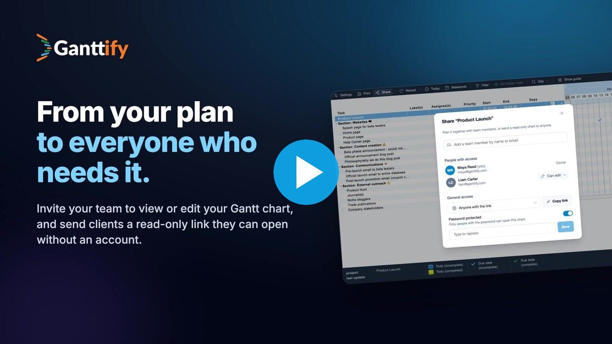

**Ganttify turns Basecamp, Todoist and Trello projects into interactive Gantt charts.** Drag tasks to new dates, link dependencies and share a read-only chart with anyone. Date changes sync back to where the work lives.

<table>
  <tr>
    <td align="center" width="20%">
      <a href="https://gantt-chart.com/features/basecamp?utm_source=github&utm_medium=org_profile">
        <picture>
          <source media="(prefers-color-scheme: dark)" srcset="images/basecamp-icon-dark.svg">
          
        </picture>
         Basecamp
      </a>
    </td>
    <td align="center" width="20%">
      <a href="https://gantt-chart.com/features/todoist?utm_source=github&utm_medium=org_profile">
        
         Todoist
      </a>
    </td>
    <td align="center" width="20%">
      <a href="https://gantt-chart.com/features/trello?utm_source=github&utm_medium=org_profile">
        
         Trello
      </a>
    </td>
    <td align="center" width="20%">
      <a href="https://gantt-chart.com/github?utm_source=github&utm_medium=org_profile">
        <picture>
          <source media="(prefers-color-scheme: dark)" srcset="images/github-icon-dark.svg">
          
        </picture>
         GitHub beta
      </a>
    </td>
    <td align="center" width="20%">
      <a href="https://gantt-chart.com/google-calendar?utm_source=github&utm_medium=org_profile">
        
         Google Calendar beta
      </a>
    </td>
  </tr>
</table>

<table>
  <tr>
    <td width="50%">
      
    </td>
    <td width="50%">
      <b>Share your chart</b> 
      Invite teammates to view or edit, or send clients a read-only link they can open without an account.
        
      <a href="https://gantt-chart.com/resources/videos?utm_source=github&utm_medium=org_profile">More video tutorials</a>
    </td>
  </tr>
</table>

[Website](https://gantt-chart.com/?utm_source=github&utm_medium=org_profile) · [Pricing](https://gantt-chart.com/pricing?utm_source=github&utm_medium=org_profile) · [Help center](https://help.gantt-chart.com/?utm_source=github&utm_medium=org_profile) · [Blog](https://gantt-chart.com/blog?utm_source=github&utm_medium=org_profile)
