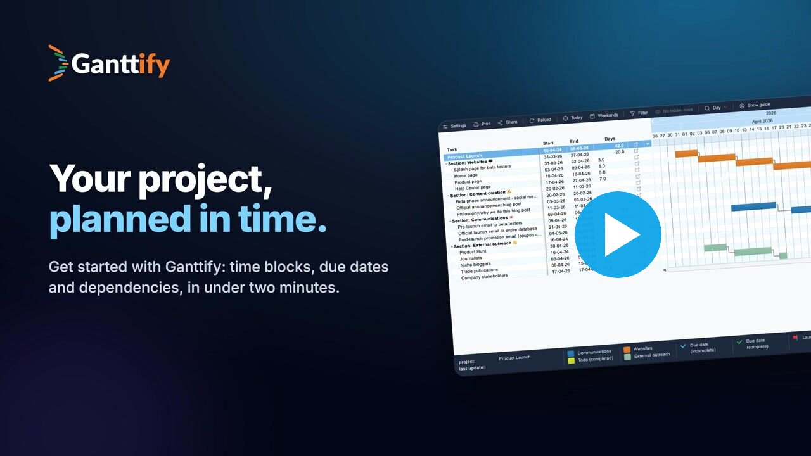

**Ganttify turns Basecamp, Todoist and Trello projects into interactive Gantt charts.** Drag tasks to new dates, link dependencies and share a read-only chart with anyone. Date changes sync back to where the work lives.

<table>
  <tr>
    <td align="center" width="72">
      <picture>
        <source media="(prefers-color-scheme: dark)" srcset="images/basecamp-icon-dark.svg">
        
      </picture>
    </td>
    <td>
      <b><a href="https://gantt-chart.com/features/basecamp?utm_source=github&utm_medium=org_profile">Gantt chart for Basecamp</a></b> 
      Plan Basecamp 2, Basecamp 3 and current Basecamp projects on one timeline. To-dos, schedule events and Card Table cards become bars you can drag, and new due dates are saved back to Basecamp. Link work across projects with dependencies, filter by project or assignee, and export the plan as a PDF.
    </td>
  </tr>
  <tr>
    <td align="center" width="72">
      
    </td>
    <td>
      <b><a href="https://gantt-chart.com/features/todoist?utm_source=github&utm_medium=org_profile">Gantt chart for Todoist</a></b> 
      See Todoist tasks as time blocks that run from their date to their deadline. Put several Todoist projects side by side, connect tasks with dependencies, and drag a task to reschedule it in Todoist. Works for team projects and for personal plans alike.
    </td>
  </tr>
  <tr>
    <td align="center" width="72">
      
    </td>
    <td>
      <b><a href="https://gantt-chart.com/features/trello?utm_source=github&utm_medium=org_profile">Gantt chart for Trello</a></b> 
      Turn Trello cards into a timeline with start and end dates. Combine boards from different workspaces into one roadmap, link cards across boards, and move a card on the chart to update its dates in Trello. Available on every Trello plan, Free included.
    </td>
  </tr>
  <tr>
    <td align="center" width="72">
      <picture>
        <source media="(prefers-color-scheme: dark)" srcset="images/github-icon-dark.svg">
        
      </picture>
    </td>
    <td>
      <b><a href="https://gantt-chart.com/github?utm_source=github&utm_medium=org_profile">Gantt chart for GitHub</a></b> invite-only beta 
      Chart GitHub issues and milestones from one or more repositories, or straight from a GitHub project. Milestones become groups, issues become bars, and blocked-by relationships show as dependency arrows, also between repositories. Rescheduled dates are written back to GitHub.
    </td>
  </tr>
  <tr>
    <td align="center" width="72">
      
    </td>
    <td>
      <b><a href="https://gantt-chart.com/google-calendar?utm_source=github&utm_medium=org_profile">Gantt chart for Google Calendar</a></b> invite-only beta 
      Lay out events from several calendars on one continuous timeline. Link events with dependencies, including across calendars, and drag them to new dates with two-way sync. Useful for combining a team's calendars to spot overlaps.
    </td>
  </tr>
</table>

[Website](https://gantt-chart.com/?utm_source=github&utm_medium=org_profile) · [Pricing](https://gantt-chart.com/pricing?utm_source=github&utm_medium=org_profile) · [Video tutorials](https://gantt-chart.com/resources/videos?utm_source=github&utm_medium=org_profile) · [Help center](https://help.gantt-chart.com/?utm_source=github&utm_medium=org_profile) · [Blog](https://gantt-chart.com/blog?utm_source=github&utm_medium=org_profile)
